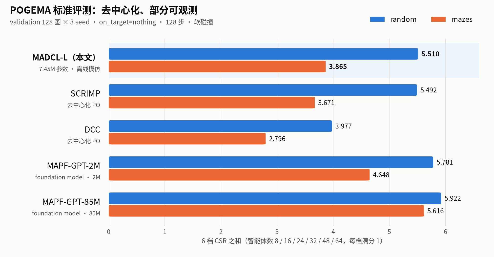
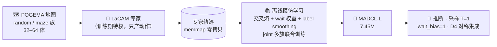
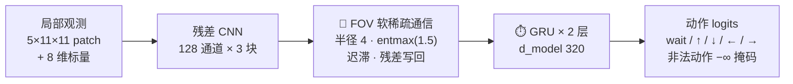

<div align="center">

# 🦎 Chameleon

**部分可观测下的去中心化多智能体路径规划：每个智能体只看得到身边 11×11 的一小块，靠"和邻居说话"协作。**


</div>

<picture>
  <source media="(prefers-color-scheme: dark)" srcset="docs/images/sq1_main_dark.png">
  
</picture>

<sub>数字是 6 档智能体数（8–64）上全员到达率（CSR）之和，每族满分 6。来源：<a href="SCHEDULE.md">SCHEDULE.md</a> §6.5「当前主表」（2026-09-24）。</sub>

---

## 📌 一句话

**MADCL**（Meta-Adaptive Decentralized Communication Learning）是一个 7.45M 参数的去中心化策略网络。它用 LaCAM 专家轨迹做**离线模仿学习**；每个智能体只用自己视野里的局部观测，加上和视野内邻居的**软稀疏通信**。在 POGEMA 标准评测上：

- 🏆 **mazes 族胜过 SCRIMP**：合计 +0.194，6 档里赢 5 档，而且赢在高密度的 32 / 48 / 64 体；
- 🤝 **random 族与 SCRIMP 打平**：+0.018，差值在噪声内，所以**不写成"赢"**；
- ✅ **两族 12 档全胜** DCC、MAMBA、QMIX、VDN、IQL、QPLEX；
- 📉 **输给 MAPF-GPT**：2M 版差 1.05，85M 版差 2.16。我们用参数量 × 数据量的 Pareto 来陈述这一点，而不是声称追平。

> 头条贡献是**通信**（FOV 受限 + entmax 软稀疏 + 迟滞），不比"泛化"。我们的结论只陈述数据支持的部分，详见下文 [§ 四个科学问题](#-四个科学问题)。

## 🧠 方法

### 流水线只有两段



没有在线强化学习阶段，没有 reward，也没有 Q 头。v2 设计里的 DQfD 和在线微调都已废弃。LaCAM 只在训练期产出专家动作，**绝不进入策略的输入**，部署时也不调用它。

### 网络：每个智能体一次前向，全体批量并行



| 部件 | 设计 | 为什么 |
|---|---|---|
| **观测** | 原生 3 通道（障碍 / 智能体 / 目标投影）+ 时间衰减足迹 + FOV 内 cost2go；标量是目标方向 + 上一步动作 + 是否到达 | 只用局部信息。cost2go 只取视野内的裁剪，和 EPH、MAPF-GPT、SCRIMP 等基线的惯例一致 |
| **通信** | 只和 FOV 内（半径 4 < 视野 5）的邻居通信；用 entmax 软稀疏注意力选邻居；迟滞让已建立的边更"粘"；`topk=6` 只是算力上限 | hard top-k 会让通信图闪烁（边界排名一交换，边就反复通断），迟滞把图的闪烁率降低 19.6% |
| **时间核** | 可插拔：GRU / Transformer / Mamba；主线用 GRU | Mamba 的增益查明是前馈结构带来的，和时序无关，所以主线不用它 |
| **元学习** | Reptile 作为可选模式保留（joint / reptile 两种）；主模型用 joint | Reptile 在零样本跨族迁移上有效，见 SQ2 |
| **推断** | 策略采样（不是 argmax）+ wait 降权 + 测试期 D4 对称集成 | 共享参数的策略用 argmax 会在对称局面下互相锁死；解码优化零训练成本，+0.143 |

## 🔬 四个科学问题

<table>
<tr><th width="22%">问题</th><th>结论（只写数据支持的部分）</th></tr>
<tr><td><b>SQ1</b><br>整体有没有竞争力？</td>
<td>

见文首的图。对**同观测假设、同去中心化约束**的对手（B 类）：mazes 胜 SCRIMP，random 与 SCRIMP 打平，两族 12 档全胜其余 6 个方法。对 foundation model 尺度的 MAPF-GPT 输，这一点如实报告。LaCAM、CBS 这类集中式满信息规划器只作为上限参照，不当对手。

</td></tr>
<tr><td><b>SQ2</b><br>元学习能不能帮助跨场景迁移？</td>
<td>

在留出的 warehouse 族上，**Reptile 初始化的零样本迁移全 6 档 ≥ joint 初始化**（3.352 vs 3.062）。但 k 步适应会把这个优势抹平：两臂适应后收敛到同一水平。⚠️ 这组对比在 2.16M 规模上做；7.45M 规模在相同梯度步数下对 Reptile 不公平，没有采用。

</td></tr>
<tr><td><b>SQ3</b> ⭐<br>通信机制有没有用？</td>
<td>

- **通信是必要的**：去掉通信，CSR 合计从 3.461 跌到 0.031，这是本节最强的结果。
- **迟滞降低通信图闪烁**：EdgeFlip −19.6%。
- **@64 高密度档的带宽 Pareto**：比 TarMAC 少 32% 的通信邻居，CSR 只差 0.016（在 CI 内），严格支配 CommNet / IC3Net / DIAL。
- **稳定压过** CommNet / IC3Net / DGN / ATOC / DIAL（都移植到同一个骨干上，只换通信模块）；**与 TarMAC、dense softmax 在 CSR 上打平**。
- **诚实的阴性结论**："软稀疏 / 迟滞优于稠密注意力"**不成立**：entmax 和迟滞各自对 CSR 的影响 **≤ 基准的 8%**（95% 置信）；在出货配置下，软稀疏省下的带宽被迟滞抵消了。

</td></tr>
<tr><td><b>SQ4</b><br>持续分布漂移下能不能保持性能？</td>
<td>

任务序列 random → mazes → warehouse 上的 final CSR：MADCL 0.570、仅 replay 0.574、顺序微调 0.543、joint 上界 0.586。三臂的遗忘率都在 0.035 左右。相对朴素顺序微调，增益很小；replay 单独就够，meta update 没有额外加成。

</td></tr>
</table>

所有数字都在**写死的评测协议**下得到：POGEMA `on_target=nothing`、128 步、`collision_system=soft`，validation-* 全 128 图，`split=all`，CSR / ISR 与 pogema 自带的 `info['metrics']` 逐 episode 对拍一致。检查点和解码超参只在**独立的 dev 集**上选（64 图 / 族，seed 段与训练、测试都不重叠），从不用测试集挑配置。完整记录见 [`SCHEDULE.md`](SCHEDULE.md) §6.5「已定论」和 [`results_v5/RESULTS.md`](results_v5/RESULTS.md)。

## 🚀 上手

### 环境

| 环境 | 用途 | 关键版本 |
|---|---|---|
| 主环境（Python 3.12） | 训练、评测 | `pogema 2.0.0a`、PyTorch 2.x |
| `lacam310`（Python 3.10） | **只**用来生成专家数据 | `lacam/_lacam.so` 是 py3.10 编译的 |
| `marlgpt` | 复现 MAPF-GPT / pogema-benchmark 基线 | `pogema==1.4.0` |

```bash
pip install torch numpy numba pyyaml
pip install -e pogema-toolbox           # 会一起装上 pogema
python scripts/env_check.py             # 自检
```

> ⚠️ **LaCAM 必须在 `lacam310` 里跑**：`_lacam.so` 在 Python 3.12 下导入失败时，`backend=auto` 会**静默**退回差得多的 prioritized 规划器，专家数据被污染也不会报错。

### 评测

主模型权重 `capbig_iter_20000.pt`（7.45M）可以从 [MAPF-Classroom 的 `weights/`](https://github.com/lncosinx/MAPF-Classroom/tree/master/weights) 取。仓库里自带的 `results_v5/MADCL_final.pt` 是 2.16M 的旧版。

```bash
python -u scripts/eval_bench.py --ckpt <capbig_iter_20000.pt> \
  --network-config configs/network_big.yaml \
  --families random,mazes --agent-counts 8,16,24,32,48,64 \
  --num-maps 128 --seeds 0,1,2 --max-steps 128 --on-target nothing \
  --action-mode sample --base-temp 1.0 --wait-bias 1.0 --tta \
  --out <结果>.json
python scripts/make_sq1_table.py --ours <结果>.json:MADCL --metric CSR
```

评测口径要在命令行里**全部显式写出来**，不要依赖默认值：这个项目已经因为默认值翻车过三次。调超参时加 `--maps-file <dev 地图目录>`（由 `scripts/make_dev_maps.py` 生成）。

### 训练

> 857 GB 专家数据已经删除，训练前要先按 [`DATA_REGEN.md`](DATA_REGEN.md) 重新生成（约 14 小时，必须用 `lacam310`）。重新生成的数据和原数据**同分布但不是同一份**，新训练的臂不能和历史臂做唯一变量对比。

```bash
# ① LaCAM 专家数据（worker 数不要超过 nproc−4）
conda activate lacam310
nice -n 19 python scripts/generate_lacam_data.py --map-type maze --num-agents 64 \
  --num-episodes 20000 --seed-start <不相交的种子段> --num-workers 12 --out <数据目录>

# ② 离线模仿学习（单卡；7.45M 训练峰值约 19.6 GiB 显存）
python -u scripts/train_il_meta.py --config configs/train_il_cap_lr1e4.yaml \
  --network-config configs/network_big.yaml --data-dir <数据目录> \
  --meta-iters 20000 --ckpt-milestones 2000,4000,...,20000 --seed 42 \
  --tag <tag> --out ckpt_il/<tag>_latest.pt
```

> 💡 判断训练效果只看 rollout，不看 loss：loss 大约 2000 步就进入平台震荡，rollout 的 CSR 要到 20000 步以上才涨到位，训练不到 25% 时不要下结论。`lr=1e-4` 是为 7.45M 选的，2.16M 更适合 5e-4，**超参不能跨臂照搬**。

## 🗂️ 仓库结构

```
configs/    network_*.yaml（big = 7.45M 主模型 / gru_c2g = 2.16M / 各类消融）  train_il_*.yaml
envs/       POGEMA 封装、观测构建（原生 3 通道 + 足迹 + cost2go）、−∞ 动作掩码、地图注册与划分
lacam/      LaCAM C++ 绑定（★ lacam310）、专家数据构建
models/     mapf_comm_net（网络组装）、spatial_encoder、communication（entmax + 迟滞）、
            temporal_core（GRU / Transformer / Mamba）、comm_baselines（6 个外部通信基线移植到同一骨干）
losses/     il_losses（交叉熵 + wait 权重 + label smoothing）
buffers/    expert_demo_buffer（memmap 零拷贝）
trainers/   train_il_reptile（joint / reptile / maml 三种模式）、evaluator
scripts/    train_il_meta（训练）· eval_bench（统一评测台）· make_dev_maps · make_sq1_table ·
            run_sq2_adaptation · run_sq4_continual · run_mapfgpt_bench
results_v5/ 各实验的结果 JSON 与汇总
```

> v2 留下的 `losses/{dqfd,td,q_target}`、`trainers/{train_reptile_dqfd,finetune_online}` 等文件还在仓库里，**但已经不用了**。

## 📚 文档

| 文档 | 管什么 |
|---|---|
| [`Lacam_DQfD_Reptile_MAPF_Plan_v2.md`](Lacam_DQfD_Reptile_MAPF_Plan_v2.md) | **方法与不变式**的事实来源（内容已是 v5，文件名沿用旧名） |
| [`SCHEDULE.md`](SCHEDULE.md) | **实验事实与结论**：§6.5「已定论」滚动维护 |
| [`CLAUDE.md`](CLAUDE.md) | 操作细节：环境、路径、进程、易错点、不变式速查 |
| [`DATA_REGEN.md`](DATA_REGEN.md) | 专家数据的重生成配方 |
| [`results_v5/RESULTS.md`](results_v5/RESULTS.md) | 结果汇总表 |

## 🏫 应用：MAPF 课堂

主模型已经用在 [**MAPF 课堂**](https://github.com/lncosinx/MAPF-Classroom)里：老师用一台 Windows 电脑开课，学生用手机扫码加入，每人控制一个智能体，空位由 MADCL 补上。断网的教室也能用。

## 🙏 致谢

[POGEMA](https://github.com/Cognitive-AI-Systems/pogema) · [pogema-toolbox](https://github.com/Cognitive-AI-Systems/pogema-toolbox) · [pogema-benchmark](https://github.com/Cognitive-AI-Systems/pogema-benchmark) · [LaCAM3](https://github.com/Kei18/lacam3) · [MAPF-GPT](https://github.com/Cognitive-AI-Systems/MAPF-GPT) · [SCRIMP](https://github.com/marmotlab/SCRIMP)
